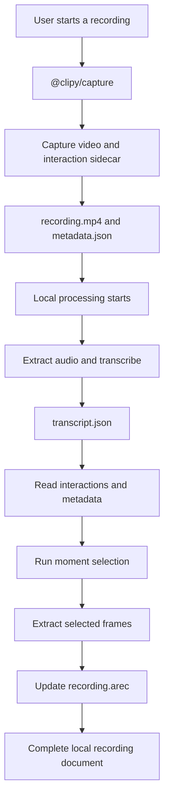

# How a recording becomes an AREC

This guide follows a local Clipy recording from screen capture through transcription and moment selection to the final `recording.arec` document.

It describes the local desktop recording path and the TypeScript packages in this repository. The TypeScript packages and Rust crates have related responsibilities, but they are separate implementations; they should not be understood as directly calling one another.

## Overview

A recording produces several pieces of evidence:

- `recording.mp4` — the captured video and any captured audio
- `metadata.json` — recording metadata
- `transcript.json` — timestamped speech segments and transcription gaps
- Interaction sidecar data — clicks, pointer activity, highlights and other interactions
- Extracted frames — screenshots selected for important moments
- `recording.arec` — the human-readable Agent Recording document that connects the evidence

The AREC document uses relative paths to reference the evidence stored alongside it.

## Recording lifecycle

## 1. Screen capture

The TypeScript capture package is:

- Package: `@clipy/capture`
- Location: `packages/capture/`
- Entry module: `packages/capture/src/index.ts`

Its public entry point exports the capture functionality, including `startCapture`, virtual-display support, source listing and capture checks.

The package uses FFmpeg for screen recording across supported operating systems. It also supports interaction sidecar data where the operating system allows it.
Its `package.json` has no runtime dependencies. Its development dependencies are `@types/node`, TypeScript and Vitest. FFmpeg is an external runtime tool rather than an npm package dependency.
Platform-specific capture implementations include:

- macOS: AVFoundation
- Windows: `ddagrab` or `gdigrab`
- Linux: X11/Xvfb-based capture paths

The resulting recording is saved as `recording.mp4`, alongside recording metadata and interaction evidence.

## 2. Local processing starts

The local desktop processing flow is implemented in:

`desktop/src-tauri/src/local/mod.rs`

The `start()` function starts a background processing thread and calls `process()`.

The processing function:

1. Locates `recording.mp4`.
2. Creates the `audio/` and `frames/` directories.
3. Loads an existing `transcript.json`, if present.
4. Starts transcription.
5. Saves the transcript.
6. Reads recording metadata and interaction evidence.
7. Writes an initial AREC document.
8. Runs moment selection and updates the recording evidence.

The processing status is updated as the recording moves through transcription and moment selection.

## 3. Transcription

The TypeScript transcription package is:

- Package: `@clipy/transcribe`
- Location: `packages/transcribe/`
- Entry module: `packages/transcribe/src/index.ts`

It provides timestamped transcript segments and supports local transcription as well as configured transcription providers.
Its runtime dependencies are `seek-bzip` and `zod`. It declares `sherpa-onnx-node` as an optional peer dependency for local speech recognition. Its development dependencies include `@types/node`, `sherpa-onnx-node`, TypeScript and Vitest. The package requires Node.js 20.19 or newer.
In the local desktop Rust implementation, transcription is handled through different platform paths.

### Non-Windows path

The function `transcribe_on_device()` in `desktop/src-tauri/src/local/mod.rs` handles these platforms.

On macOS, live transcription can begin while the recording is being captured. Once recording stops, the processing flow waits for the live session to finish.

If live transcription cannot provide a usable result, the implementation can fall back to transcription from the saved recording file.

### Windows

Windows uses `local_edition_transcribe()` from `desktop/src-tauri/src/local/mod.rs`, which delegates to the local edition transcription implementation in:

`desktop/src-tauri/src/local/edition.rs`

The Windows implementation supports local models and configured providers.

The Rust speech-to-text crate is:

- Crate: `clipy-local-stt`
- Location: `desktop/src-tauri/crates/clipy-local-stt/`

It produces timestamped transcripts from 16 kHz mono audio. It supports on-device speech recognition through `sherpa-onnx` and transcription through the user's configured provider key.

Its optional `local` feature enables the `sherpa-onnx-sys` engine. The `static` and `shared` features control how the native sherpa-onnx libraries are linked. Its other dependencies include `reqwest`, `serde`, `serde_json`, `sha2`, `bzip2`, `tar`, `dirs`, `thiserror` and `base64`, with additional platform-specific dependencies for Unix and Windows.

The desktop implementation calls `clipy_local_stt::transcribe_local()` for local model transcription and `clipy_local_stt::transcribe_with_provider()` for provider-based transcription.

The resulting timestamped segments and any gaps are written to `transcript.json`.

The TypeScript package `@clipy/transcribe` and Rust crate `clipy-local-stt` serve related transcription responsibilities in their respective implementations.

## 4. Moment selection

The TypeScript moments package is:

- Package: `@clipy/moments`
- Location: `packages/moments/`
- Entry module: `packages/moments/src/index.ts`

It selects useful moments from transcript and interaction evidence.
Its runtime dependency is `zod`. Its development dependencies are `@types/node`, TypeScript and Vitest. The package requires Node.js 20.19 or newer. Its prebuild, pretypecheck and pretest scripts run `scripts/sync-from-monorepo.mjs` to prepare generated source files before those operations.

The local desktop Rust implementation has its moment-selection flow in:

`desktop/src-tauri/src/local/edition.rs`

The `moments()` function combines two sources of evidence:

### Deterministic rules

Rules-based selection always runs. It uses transcript segments and interaction information through the sidecar rules input.

This covers interaction evidence such as highlights, pen drawings, clicks and pointer rests.

### Spoken cues from a model provider

When a model provider is configured and a transcript is available, Clipy builds provider input and calls `plan_with_provider()`.

If the provider is unavailable, the transcript is empty, or the provider request fails, the implementation falls back to rules-based selection.

The provider outcome is recorded in the recording disclosure information.

The Rust local moments crate is:

- Crate: `clipy-local-moments`
- Location: `desktop/src-tauri/crates/clipy-local-moments/`

The TypeScript `@clipy/moments` package and Rust `clipy-local-moments` crate have related responsibilities in their respective implementations.
Its dependencies are `serde`, `serde_json`, `thiserror` and `reqwest`. The `reqwest` client uses JSON and Rustls TLS features. Its development dependency is `tokio`, used for asynchronous tests.
For a deeper explanation of moment selection, see the [Moments guide](https://github.com/clipy-recorder/clipy/issues/73).

## 5. Generated moment-planning code

The directory:

`packages/moments/src/generated/`

contains generated copies of shared moment-planning code.

The synchronization script is:

`scripts/sync-from-monorepo.mjs`

The script prepares the open-source copies of shared code from the monorepo source files. It copies selected implementations and types into the generated directory and rewrites selected imports for the open-source package layout.

The script also checks generated files for forbidden internal terms.

The moments package runs this script before its build, typecheck and test commands.

In the exported open-source repository, the original monorepo `lib/` directory is not present, so the script is a no-op.

Generated files should be treated as synchronized output rather than independently maintained source files.

## 6. AREC document creation

The AREC document is created by the `write_arec()` function in:

`desktop/src-tauri/src/local/mod.rs`

It receives:

- Recording directory
- Recording metadata
- Transcript
- Interaction evidence
- Extracted frames
- Processing completion status

The function builds a Markdown document containing:

- AREC specification version and recording profile
- Recording title and description
- Deep link to open the recording in Clipy
- Recording ID and duration
- Links to the video, transcript and metadata
- Evidence boundaries
- Capture gaps and processing status
- Instructions for inspecting the recording

The document is first written to a temporary file:

`recording.arec.tmp`

It is then renamed to:

`recording.arec`

This avoids exposing a partially written AREC document.

An initial AREC can be written while moment selection is still pending. The processing flow later updates it with the available transcript, frames and final completion status.
After moment selection, the `complete()` function in the same module extracts the selected screenshots from `recording.mp4`. It sends the requested timestamps and output paths to the native frame extraction operation in one call.

Successful screenshots are saved under `frames/`, and their timestamps, actual extracted frame times, reasons and evidence sources are recorded in `frames.json`. Frames that cannot be decoded are recorded as capture gaps in a separate frame-gaps file; an extraction failure that interrupts processing returns an error.

When selection succeeds, the processing flow reclaims temporary data and writes the final AREC with a `Complete` status. If moment selection is unavailable, it writes the AREC with the selection-unavailable status instead. The AREC reads the frame index and frame gaps when it is generated.
The Rust crate `clipy-local-edition`, located at `desktop/src-tauri/crates/clipy-local-edition/`, provides local-edition functionality used by the desktop implementation.
The crate uses Rust 2021 and requires Rust 1.82 or newer. It depends on `clipy-local-moments`, and optionally on `clipy-local-stt` through its `stt` feature. The desktop application enables this feature for its Windows transcription path. Other dependencies are `serde`, `serde_json` and `url`.

## 7. Plugins and the Clipy CLI

Plugins are an important part of the wider Clipy ecosystem.

They drive the Clipy CLI, which lives outside this repository. The CLI should therefore not be treated as an application package or entry point contained in this repository.

This repository documents the recording and local desktop evidence pipeline. Plugin and CLI behavior belongs to the wider Clipy architecture.

## Summary

A local recording moves through capture, transcription, moment selection and AREC generation.

The TypeScript packages provide reusable capture, transcription and moment-selection functionality. The desktop application's Rust implementation has corresponding local processing code and dedicated crates.

The final `recording.arec` document connects the recording's metadata, transcript, interactions and extracted frames into one portable, inspectable recording document.